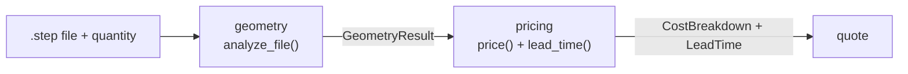
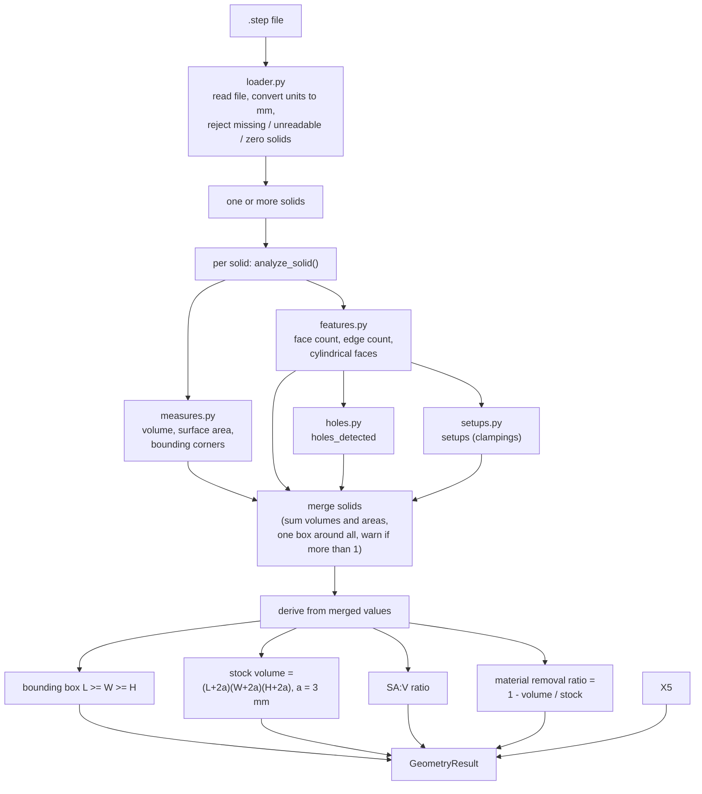
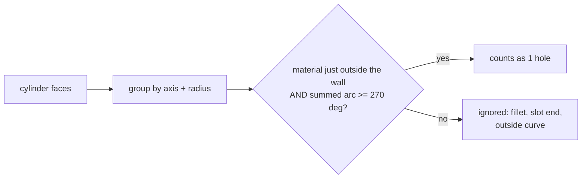
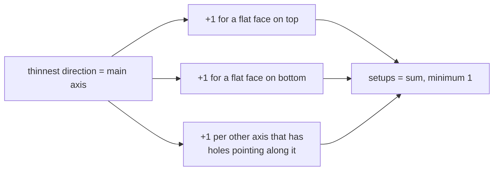
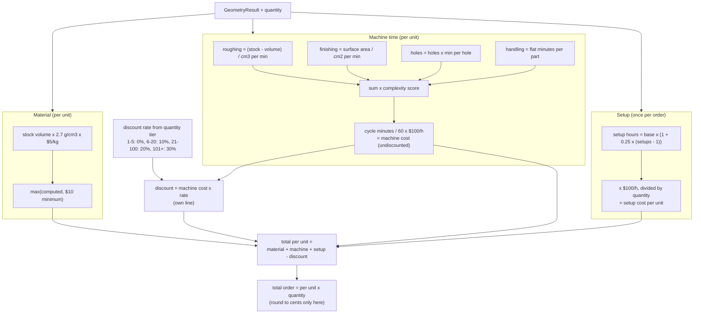
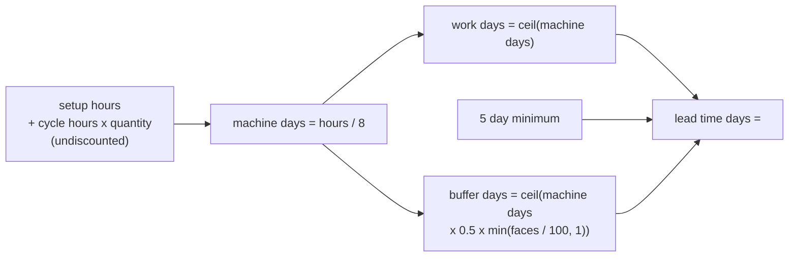

# Engine flow: geometry and quote estimation

Diagrams render on GitHub and in VS Code (Mermaid). Code lives in `backend/geometry/` and
`backend/pricing/`. Both are pure: no web, no database.

## 1. Big picture

## 2. Geometry engine (STEP file in, GeometryResult out)

### What each feature means (plain language)

| Feature | Meaning | Why pricing cares |
|---|---|---|
| Bounding box | Smallest straight-edged box around the part | Sets the raw block size to buy |
| Stock volume | Bounding box plus 3 mm of extra on every side | Material is bought as a block, not as the finished shape |
| Volume | Space the metal takes up | Stock minus volume = metal cut away (roughing time) |
| Surface area | Total outside skin of the part | Every surface needs a finishing pass |
| Face | One continuous surface (a flat side, a curved wall) | Many small faces (gear teeth) = more machining detail |
| Hole | Cylinder wall with material around it, covering at least 270 deg of the circle | Drilling time per hole |
| Setup | One clamping of the part on a 3-axis machine | Each re-clamp costs operator time |
| Complexity score | Planned 1.0 to 3.0 multiplier for hard parts | **Not built yet** (pricing uses 1.0) |

### Hole rule

### Setup rule (3-axis machine)

Sample results: gear = 2, bracket = 4.

## 3. Quote estimation (GeometryResult + quantity in, CostBreakdown + LeadTime out)

All constants come from one `PricingConfig` (`pricing/config.py`).

### Lead time

Discounts never shorten lead time.

## 4. Open work

| Item | State |
|---|---|
| Pricing constants | Placeholders (roughing, finishing, per-hole, handling, base setup). Tune against competitor quotes: setup hours first (drives qty 1), then cycle time (drives qty 100). |
| Complexity buffer | Face count only; the 100-face cap and 50% max rate are assumptions from two samples. Setups and thin walls are not included. |
